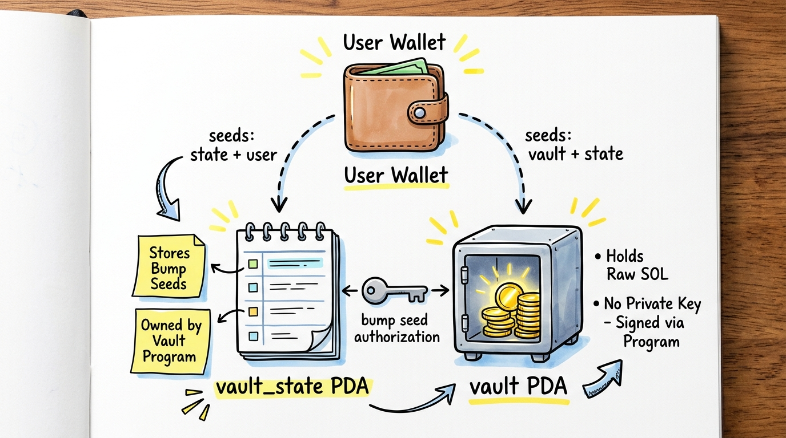
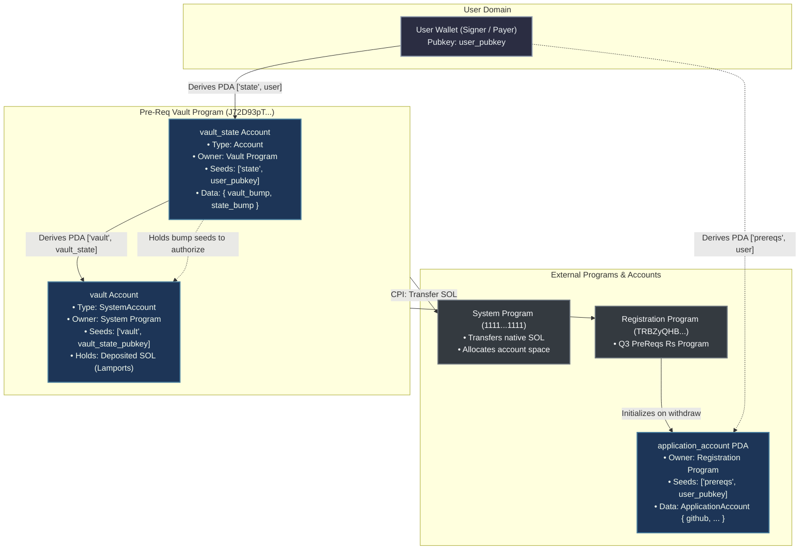
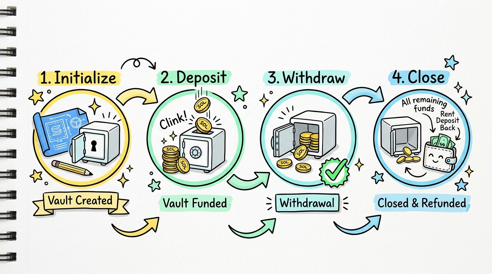
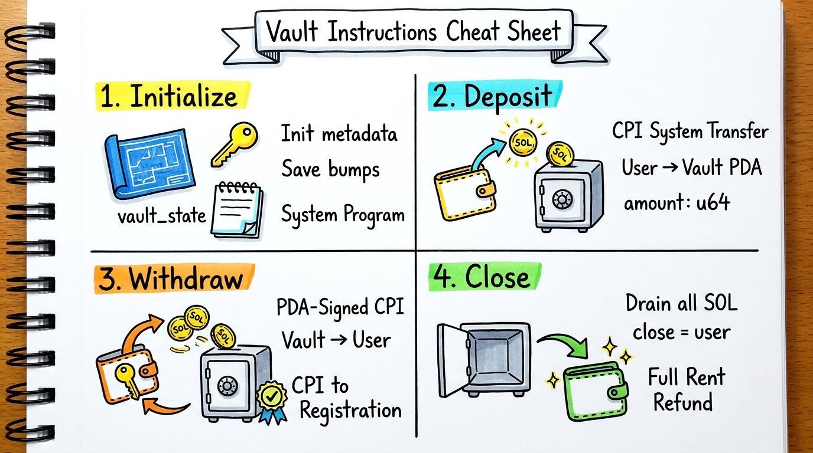

# Pre-Req Vault Program (Solana / Anchor)

A secure, personal on-chain savings and escrow vault built on Solana using the **Anchor framework**.

Each user can initialize their own dedicated vault, deposit native SOL, withdraw funds (with integrated Cross-Program Invocation to the prerequisite registration contract), and close the vault to reclaim 100% of their rent and remaining funds.

---

## 1. System Architecture & Two-PDA Model

The program strictly decouples **state metadata** from **SOL custody** using two Program Derived Addresses (PDAs):



### Why Two PDAs?

1. **`vault_state` PDA** (`seeds = [b"state", user.key()]`):

   - **Type:** Anchor data account storing `VaultState`.
   - **Owner:** Vault Program (`J72D93pT...`).
   - **Role:** Keeps track of the bump seeds (`vault_bump` and `state_bump`) used to verify authority and sign on behalf of the vault PDA during withdrawals and closing.

2. **`vault` PDA** (`seeds = [b"vault", vault_state.key()]`):
   - **Type:** `SystemAccount` (0-data account owned by Solana's System Program).
   - **Role:** Acts as the decentralized piggy bank holding native lamports (SOL).
   - **Security:** Because it is a PDA, no private key exists for it. Only the Vault Program can authorize transfers out of it using `CpiContext::new_with_signer` and its derivation seeds.

### Account Relationship & CPI Map



---

## 2. Overall Application Flow

A user's vault follows a predictable 4-step lifecycle:



### Sequence Diagram

```mermaid
sequenceDiagram
    autonumber
    actor User as User Wallet
    participant VaultProg as Pre-Req Vault Program
    participant SysProg as System Program
    participant RegProg as Registration Program

    %% 1. Initialize
    rect rgb(28, 40, 51)
    Note over User,SysProg: 1. Initialize Step
    User->>VaultProg: initialize()
    VaultProg->>SysProg: Allocate vault_state & transfer rent
    VaultProg-->>User: vault_state saved with [vault_bump, state_bump]
    end

    %% 2. Deposit
    rect rgb(21, 67, 96)
    Note over User,SysProg: 2. Deposit Step
    User->>VaultProg: deposit(amount: 1 SOL)
    VaultProg->>SysProg: CPI transfer(from: User, to: vault_pda, 1 SOL)
    SysProg-->>VaultProg: Transferred
    end

    %% 3. Withdraw & Register
    rect rgb(19, 78, 74)
    Note over User,RegProg: 3. Withdraw & Registration Step
    User->>VaultProg: withdraw(amount: 0.5 SOL)
    VaultProg->>SysProg: CPI transfer with PDA Signer (vault -> User, 0.5 SOL)
    SysProg-->>VaultProg: Transferred
    VaultProg->>RegProg: CPI initialize(github: "domkoder")
    RegProg-->>VaultProg: application_account initialized!
    end

    %% 4. Close
    rect rgb(74, 35, 90)
    Note over User,SysProg: 4. Close Step
    User->>VaultProg: close()
    VaultProg->>SysProg: CPI transfer with PDA Signer (remaining SOL -> User)
    VaultProg->>User: Close vault_state, refund rent deposit
    end
```



### State & Balance Transition Matrix

| Stage             | Action              | `vault_state` PDA                          | `vault` PDA Balance        | `user` Balance Effect              |
| :---------------- | :------------------ | :----------------------------------------- | :------------------------- | :--------------------------------- |
| **0. Initial**    | None                | Does not exist                             | 0 SOL                      | Baseline                           |
| **1. Initialize** | `initialize()`      | Created (saves `vault_bump`, `state_bump`) | 0 SOL                      | - Rent for `vault_state` - tx fee  |
| **2. Deposit**    | `deposit(1 SOL)`    | Unchanged                                  | +1.0 SOL                   | -1.0 SOL - tx fee                  |
| **3. Withdraw**   | `withdraw(0.5 SOL)` | Unchanged                                  | -0.5 SOL (0.5 SOL remains) | +0.5 SOL - tx fee                  |
| **4. Close**      | `close()`           | **Closed & Erased**                        | **0 SOL** (Drained)        | + Remaining SOL + Full rent refund |

---

## 3. Instruction Breakdown



### 1. `initialize` ([programs/pre-req-vault/src/instructions/initialize.rs](programs/pre-req-vault/src/instructions/initialize.rs))

- **Purpose:** Creates and initializes the user's `vault_state` metadata account.
- **Accounts:**
  - `user` (`Signer`, `mut`): Payer for account rent.
  - `vault_state` (`Account<VaultState>`, `init`, `payer = user`): Space sized to `8 + VaultState::INIT_SPACE`.
  - `vault` (`SystemAccount`): PDA derived from `[b"vault", vault_state.key()]`.
  - `system_program`: Creates the account on-chain.
- **Execution:** Anchor creates `vault_state` and saves `bumps.vault` and `bumps.vault_state`.

### 2. `deposit` ([programs/pre-req-vault/src/instructions/deposit.rs](programs/pre-req-vault/src/instructions/deposit.rs))

- **Purpose:** Deposits native SOL from the user's wallet into the `vault` PDA.
- **Parameters:** `amount: u64` (lamports to deposit).
- **Accounts:** `user` (`Signer`, `mut`), `vault` (`SystemAccount`, `mut`), `vault_state` (`Account<VaultState>`), `system_program`.
- **Execution:** Makes a CPI to the System Program to transfer `amount` from `user` to `vault`.

### 3. `withdraw` ([programs/pre-req-vault/src/instructions/withdraw.rs](programs/pre-req-vault/src/instructions/withdraw.rs))

- **Purpose:** Withdraws SOL from the `vault` PDA back to the user, and triggers registration CPI.
- **Parameters:** `amount: u64` (lamports to withdraw).
- **Accounts:** `user` (`Signer`, `mut`), `vault` (`SystemAccount`, `mut`), `vault_state` (`Account<VaultState>`), `application_account` (`UncheckedAccount`), `application_program` (`Program<Q3PreReqsRs>`), `system_program`.
- **Execution:**
  1. Signs with `vault` seeds (`[b"vault", vault_state.key(), &[vault_bump]]`) and executes CPI transfer to return SOL to `user`.
  2. Executes CPI to the external `Q3PreReqsRs` registration program calling `initialize(github: "domkoder")`.

### 4. `close` ([programs/pre-req-vault/src/instructions/close.rs](programs/pre-req-vault/src/instructions/close.rs))

- **Purpose:** Drains all remaining funds from `vault` and closes `vault_state`.
- **Accounts:** `user` (`Signer`, `mut`), `vault` (`SystemAccount`, `mut`), `vault_state` (`Account<VaultState>`, `mut`, `close = user`), `system_program`.
- **Execution:**
  1. Transfsers all remaining `vault.lamports()` back to `user` using PDA signer seeds.
  2. Anchor's `close = user` zero-initializes `vault_state` and refunds its rent lamports back to `user`.

---

## 4. Development & Testing

### Build the Program

```bash
anchor build
```

### Run Tests

#### TypeScript Integration Tests (`tests/pre-req-vault.ts`)

Run against Solana Devnet or localnet using Anchor:

```bash
anchor test
```

Or run directly using Yarn:

```bash
yarn run ts-mocha -p ./tsconfig.json -t 1000000 tests/pre-req-vault.ts
```

#### Rust Unit / SVM Tests (`tests/test_initialize.rs`)

Test on-chain logic fast via LiteSVM:

```bash
cargo test
```

---

## 5. Addresses & Configuration

| Parameter                   | Value                                          |
| :-------------------------- | :--------------------------------------------- |
| **Vault Program ID**        | `J72D93pT1FMFN3tAXjnBcYWT5c4UeZR72vcPeD5nJvZY` |
| **Registration Program ID** | `TRBZyQHB3m68FGeVsqTK39Wm4xejadjVhP5MAZaKWDM`  |
| **Solana Cluster**          | Devnet (`https://api.devnet.solana.com`)       |
